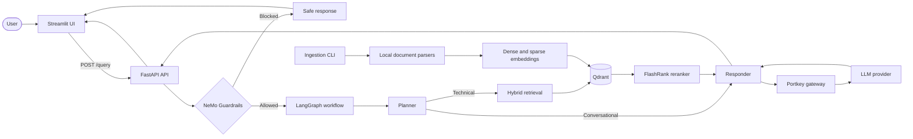

# Enterprise Agentic RAG

An enterprise-document assistant for Kubernetes, Intel, and networking content. It ingests local documents, stores hybrid vectors in Qdrant, retrieves and reranks relevant chunks, and answers through a LangGraph workflow.

## What it does

- Parses PDF, HTML, text, DOCX, and PPTX documents from `DATA/`.
- Creates Gemini dense embeddings and FastEmbed BM25 sparse vectors.
- Searches a Qdrant hybrid collection with RRF fusion, then reranks chunks with FlashRank.
- Applies NeMo Guardrails before the LangGraph planner/retriever/responder workflow.
- Provides FastAPI, Streamlit, and an optional evaluation interface.

## Architecture



Print the complete Mermaid source with:

```powershell
python architecture.py
```

## Repository layout

```text
app/
  agent/              LangGraph workflow and nodes
  evaluation/         Offline hybrid-retrieval metrics
  gateway/            Portkey client configuration
  guardrails/         NeMo guardrail rules and setup
  ingestion/          Parsers, chunking, and Qdrant indexing CLI
  services/retrieval/ Embeddings, Qdrant search, and reranking
  main.py             FastAPI application
ui/                    Streamlit chat interfaces
evals/                 Evaluation pipeline, metrics, and Streamlit UI
tests/                 Unit tests
DATA/                  Input documents
processed_data/        Generated ingestion checkpoints and parsed output
architecture.py        Mermaid architecture-diagram generator
```

## Prerequisites

- Python 3.11 or later
- A Qdrant Cloud cluster or compatible Qdrant endpoint
- Gemini API key for dense embeddings
- Portkey API key and a configured Portkey gateway/model
- Groq API key for NeMo Guardrails

## Setup

```powershell
py -3.11 -m venv .venv
.\.venv\Scripts\Activate.ps1
python -m pip install --upgrade pip
python -m pip install -r requirements.txt
Copy-Item .env.example .env
```

Configure `.env`:

```env
# Answer generation and planning
PORTKEY_API_KEY=""

# Hybrid retrieval and ingestion
QDRANT_CLUSTER_ENDPOINT="https://your-cluster.cloud.qdrant.io:6333"
QDRANT_API_KEY=""
QDRANT_HYBRID_COLLECTION="ENTERPRISE_RAG_CHATBOT"
GEMINI_API_KEY=""

# NeMo Guardrails
GUARDRAIL_API_KEY=""

# Optional observability
LOGFIRE_TOKEN=""
LANGSMITH_TRACING="true"
LANGSMITH_API_KEY=""
LANGSMITH_PROJECT="enterprise-rag"

# Local UI to API connection
BACKEND_URL="http://127.0.0.1:8000"

# Optional evaluation judge-key rotation
JUDGE_GROQ_API_KEY=""
JUDGE_GROQ_API_KEY_2=""
```

Do not commit `.env`; it is ignored by Git.

## Ingest documents

```powershell
python -m app.ingestion.processor DATA
```

Use `--wipe` only when you intentionally want to delete and recreate the configured hybrid collection.

```powershell
python -m app.ingestion.processor DATA --wipe
```

## Run the application

Start FastAPI:

```powershell
python -m uvicorn app.main:app --reload --port 8000
```

Then start the local Streamlit interface in another terminal:

```powershell
python -m streamlit run ui/app.py
```

Open `http://127.0.0.1:8000/docs` for the API schema while the backend is running.

## Run tests

```powershell
python -m pytest tests -q
```

`test_judge.py` is an optional manual connectivity check. It makes a real Groq API request only when run directly:

```powershell
python test_judge.py
```

## Run evaluations

Start the backend first, then run:

```powershell
python -m streamlit run evals/app.py
```

Evaluation checkpoints are saved under `evals/results/`. Rerun the pipeline after changing the model, input data, or retrieval configuration.
